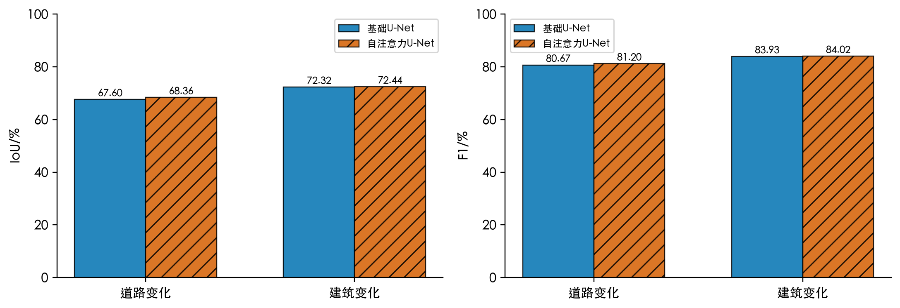
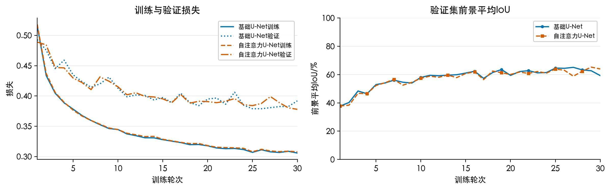
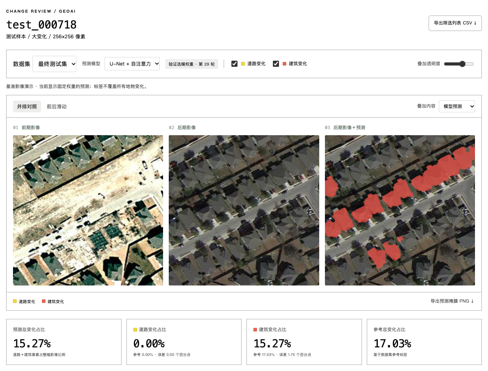

# 双时相遥感建筑与道路变化识别

深圳大学《地理空间智能导论》期末课程项目。使用 LEVIR-MCI，比较轻量 U-Net 与增加一个瓶颈自注意力增强块后的变化分割效果，并提供变化结果浏览与辅助巡查工具。

输入是同一区域两期已配准的 256×256 RGB 影像，拼接为 6 通道；输出是背景、道路变化、建筑变化三类掩膜。识别的是已经发生的目标变化，不预测未来建设，也不直接判断新建、拆除、违法性或原因。

## 实测结果

清理后训练 / 验证 / 测试为 **6,794 / 1,333 / 1,929 对**。两个模型各训练 30 轮，只有一组匹配随机种子 42；按完整验证集选中第 27 / 29 轮，固定权重后评价全部测试样本。

| 模型 | 道路 IoU / % | 建筑 IoU / % | 前景平均 IoU / % | 道路 Recall / % | 参数量 |
|---|---:|---:|---:|---:|---:|
| 轻量 U-Net | 67.60 | 72.32 | 69.96 | 83.70 | 1,964,563 |
| U-Net + 瓶颈增强块 | 68.36 | 72.44 | 70.40 | 79.82 | 2,491,667 |

增强模型前景平均 IoU 高 **0.44 个百分点**，道路 Precision 提高而 Recall 下降；不能称为全面改进或稳定增益。参数量增加约 26.8%。完整分割、面积、空样本与排序指标见 [测试汇总](results/完整测试结果汇总.csv) 和两模型逐图 CSV。





前 20%（386 张）按预测规模排序的影像覆盖约 74.5% 的真实变化像素，但只覆盖约 39.45% 的含变化影像。这个离线指标不代表已经节省的人工工时。小变化仍是主要不足；未验证多种子稳定性或跨城市、跨传感器泛化。

## 仓库内容

- `models.py`、`formal_train.py`、`final_test.py`：本项目实际使用的模型、训练和固定权重测试代码。
- `configs/`：冻结的训练、续训和测试协议；包含样本与权重校验信息。
- `evidence/`：数据来源、清理清单、归一化、逐类审计和验证记录。
- `runs/`：实际每轮与每步日志、配置、逐图指标，以及本项目生成的验证 / 测试预测掩膜。历史归档不覆盖。
- `results/figures/`：蓝橙配色的统计图、五列对照、误报漏检与浏览界面图。
- `application/`、`patrol_server.py`：本机结果浏览工具；支持两模型、两期对照、图层、排序和导出。
- [实验与 AI 使用记录](docs/实验与AI使用记录.md)、[来源与引用](docs/来源与引用.md)。

源数据不在 Git 中复制，**数据可从作者官方入口获取**，版本、大小和 SHA-256 已固定。权重通过 [v1.0-course 发布](https://github.com/jupiterinjuly/geoai-levir-change-detection/releases/tag/v1.0-course) 提供；课程含个人学号的 Word 封面与报告留在本地。

## 先核对公开结果

不下载数据、不安装深度学习依赖，也可检查归档数字：

```bash
python3 scripts/verify_results.py
```

检查逐图数量、混淆矩阵、IoU / P / R / F1、面积误差、变化分组、排序覆盖率及文件校验值。它核验归档内部一致性，不等同于独立训练，也不替代对真实标签语义的判断。

## 下载数据与权重

原实验为 Python 3.12.3、PyTorch 2.5.1，Apple M1 8 GB、MPS float32。创建环境后安装 `requirements.txt`；完整历史环境另存 `requirements-lock.txt`，不保证其他平台可直接安装所有固定版本。

```bash
python3 -m venv .venv
source .venv/bin/activate
python -m pip install -r requirements.txt
python scripts/get_data.py
python scripts/download_checkpoints.py
```

数据约 2.77 GB，下载与解压需要另外的磁盘空间。下载脚本校验压缩包，保留官方目录 `data/LEVIR-MCI-dataset/images/{train,val,test}/{A,B,label,label_rgb}`。训练排除只体现在清单中，原始文件不删除。

- 官方项目：[Chen-Yang-Liu/Change-Agent](https://github.com/Chen-Yang-Liu/Change-Agent)
- 数据文件：[lcybuaa/LEVIR-MCI](https://huggingface.co/datasets/lcybuaa/LEVIR-MCI)
- 数据版本：`dff09c709999b5b1f1f1806024811c65a6b14dfe`
- 压缩包 SHA-256：`8f7d52298fa3ca32aec983e84addef80f61ad7d981c0ff97a92c5880c4b83e9d`

实际标签为背景黑、道路黄、建筑红；灰度值 0 / 128 / 255 逐像素核对一致。上游 readme 的道路颜色与实际文件不一致，以实际审计记录为准。背景仅指未标注这两类变化，不表示其他地物完全不变。

## 浏览与推理

完成数据与权重准备后：

```bash
python patrol_server.py
```

打开 `http://127.0.0.1:8791`。默认浏览验证集，可切换完整测试集。支持前后并排或滑动查看、两模型、道路 / 建筑图层、参考与错误图、规模筛选以及 PNG / CSV 导出。也可上传已配准的 256×256 RGB 影像对，在本机 CPU 推理；无标签输入不显示该影像精度。



“辅助巡查”表示便于检查候选区域，不是已经验证或部署的业务系统；无可靠坐标和分辨率时仅显示像素占比。

## 重新评价或训练

在新目录重新评价发布的权重，支持 CPU / MPS，不覆盖归档：

```bash
python scripts/evaluate_checkpoint.py --model baseline --device cpu --out local_runs/baseline_cpu
python scripts/evaluate_checkpoint.py --model attention --device mps --out local_runs/attention_mps
```

可加 `--limit 2` 做短诊断，输出明确标注 partial，不能作为完整测试结果。原始 `final_test.py` 保留当时固定 MPS 与哈希协议，便于审计。

原正式训练程序限制正式设备为 MPS；CPU 仅用于 `--smoke` 诊断。重新训练请使用新输出目录：

```bash
for epoch in $(seq 1 30); do
  python formal_train.py --model baseline --until-epoch "$epoch" --out local_runs/train_baseline
  python formal_train.py --model attention --until-epoch "$epoch" --out local_runs/train_attention
done
```

程序支持断点恢复并核对配置。实际模型选择按验证前景平均 IoU，同分取较早轮次，最多 30 轮、7 轮无改善早停。重新实验的最优权重可通过 `evaluate_checkpoint.py --checkpoint ...` 评价，但不能用测试结果继续调参。MPS 位级结果不保证重现；其他训练设备的适配尚未完成。

## 归档与来源

实验于 2026-11-20 至 2026-11-23 实际运行，2026-11-23 整理公开。代码自行实现；数据和任务来自 Change-Agent / LEVIR-MCI，不是完整 Change-Agent 复现。训练期系统补丁变化、单种子限制及另一个预训练模型曾预览 6 对测试影像等情况均在记录中披露。

本仓库代码采用 MIT 许可证；数据与论文图像归原作者所有，代码许可证不授予第三方数据再分发权。详细出处见[来源与引用](docs/来源与引用.md)。
